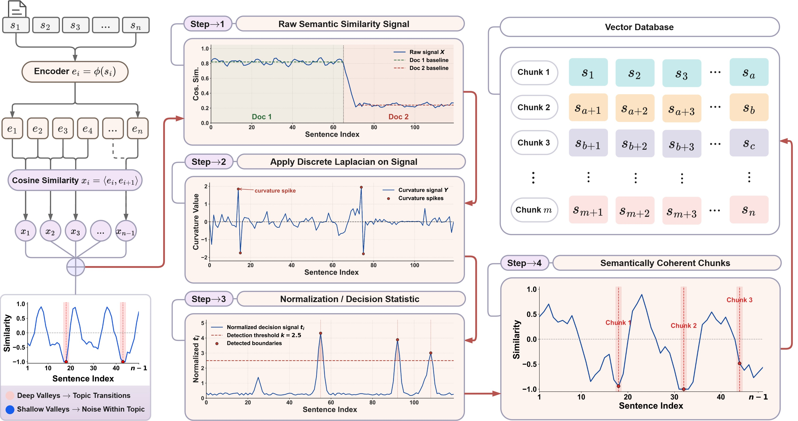
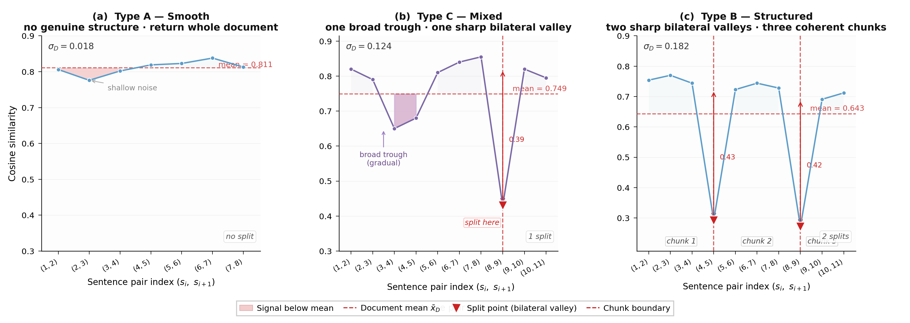
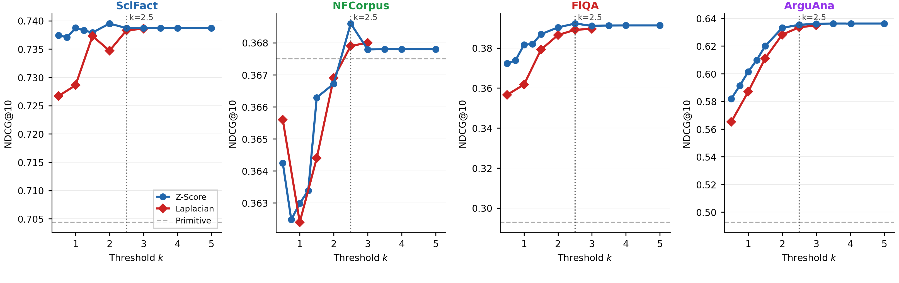

<h1 align="center">SEISMOS</h1>

<h3 align="center">A Statistical Signal Detection Framework for Semantic Chunking</h3>

<p align="center">
  <b>Ishtiak Mahmud Saad</b><sup>1</sup> &middot;
  <b>Mominul Islam</b><sup>2</sup> &middot;
  <b>Shahriyar Zaman Ridoy</b><sup>3,5</sup> &middot;
  <b>Md Manjurul Ahsan</b><sup>4,5</sup> &middot;
  <b>Azmine Toushik Wasi</b><sup>5</sup>
  <br>
  <sup>1</sup>Rajshahi University of Engineering &amp; Technology &nbsp;
  <sup>2</sup>Tulane University &nbsp;
  <sup>3</sup>North South University &nbsp;
  <sup>4</sup>University of Oklahoma &nbsp;
  <sup>5</sup>CIOL
  <br><br>
  <b>NeurIPS 2026</b>
</p>

<p align="center">
  <a href="#"></a>
  <a href="https://seismos-sc.github.io"></a>
  <a href="pyproject.toml"></a>
  <a href="LICENSE"></a>
</p>

<p align="center">
  
</p>

> **TL;DR.** SEISMOS treats chunking as signal detection. It embeds each
> sentence and measures how similar each one is to the next. A chunk boundary is
> placed wherever the curvature of that similarity signal is statistically
> significant. The threshold is `k = 2.5` for every corpus, encoder and language
> in the paper. The method makes no LLM calls and needs no tuning.

### Highlights

- **Best chunker on all five BEIR datasets.** It beats fixed, recursive, LangChain and LlamaIndex chunking with one fixed `k`, including on held-out TREC-COVID.
- **More faithful RAG answers.** On LongBench NarrativeQA, HHEM faithfulness is **0.687**, against 0.589–0.644 for the baselines. Retrieved-evidence nDCG@5 rises from 0.106–0.113 to 0.190.
- **15–23× cheaper** to run than production semantic chunkers: 0.13 s per document, against 2.0–3.1 s.
- **Transfers without retuning.** It stays competitive with strong fixed-length chunking on long documents (DAPR, ConTEB) and in German, Japanese and Arabic (MIRACL), across four encoders.

## Quick start

```bash
pip install -e .
```

```python
from seismos import Encoder, SeismosChunker

encoder = Encoder.from_name("bge")        # bge | e5 | gte | gte-multi | me5
chunker = SeismosChunker(encoder, k=2.5, max_tokens=480)

for chunk in chunker.chunk(text):
    print(chunk.start, chunk.end, chunk.text)
```

`max_tokens` is an optional budget. Sentences between boundaries are packed up
to that limit, and no sentence is ever split. For German, Japanese or Arabic,
pass `lang="de" | "ja" | "ar"` and use a multilingual encoder. To see the
signal and the decision statistic plotted for a three-topic document, open
[`notebooks/quickstart.ipynb`](notebooks/quickstart.ipynb).

## Method

```
X_i = cos(φ(s_i), φ(s_{i+1}))          adjacent-sentence similarity
D_i = X_{i+1} − 2·X_i + X_{i−1}        discrete Laplacian
boundary after sentence i  ⇔  −D_i / std(D) > k
```

Across BEIR corpora, the similarity signal has three consistent properties:

- Documents are either smooth or clearly segmented.
- Shallow local minima are mostly noise.
- Adjacent similarities are positively autocorrelated.

The Laplacian normalised by the document's own `std(D)` accounts for all three.
It removes each document's similarity scale and absorbs its autocorrelation:
under AR(1), `Var(D) = σ²(6 − 8ρ + 2ρ²)`. A smooth document has no significant
curvature, so it stays whole. A structured document is cut at its sharp
transitions.

<p align="center">
  
</p>

Because the statistic is normalised for each document, one threshold works
everywhere. Retrieval quality reaches a plateau at `k ≈ 2.5` on every BEIR
development corpus:

<p align="center">
  
</p>

If you already have embeddings, the detectors work directly on a similarity
array:

```python
from seismos import laplacian_splits

boundaries = laplacian_splits(X, k=2.5)   # i in boundaries: cut after sentence i
```

## Results

**Zero-shot BEIR**, nDCG@10 (%), BGE-base. † marks the held-out corpus, which was run with no parameter change.

| Chunker | ArguAna | FiQA | NFCorpus | SciFact | TREC-COVID† |
|:--|:-:|:-:|:-:|:-:|:-:|
| Fixed (best size) | 60.62 | 39.04 | 36.36 | 74.22 | 69.81 |
| Recursive (best size) | 59.91 | 39.35 | 37.33 | 74.42 | 70.00 |
| LangChain `SemanticChunker` | 63.62 | 39.18 | 36.78 | 73.57 | 66.90 |
| LlamaIndex `SemanticSplitter` | 56.85 | 35.68 | 37.05 | 72.53 | 66.24 |
| **SEISMOS** (`k = 2.5`) | **63.63** | **39.50** | **37.63** | **74.55** | **71.35** |

**End-to-end RAG** on LongBench NarrativeQA (E5-base-v2, top-5, Qwen2.5-7B-Instruct). Only the chunker changes between rows.

| Chunker | QA F1 | Faithfulness (HHEM) | Human correctness | Evidence nDCG@5 | s / doc |
|:--|:-:|:-:|:-:|:-:|:-:|
| Fixed@480 | 0.108 | 0.589 | 0.381 | 0.113 | 0.0004 |
| Recursive | 0.111 | 0.603 | 0.333 | 0.113 | 0.436 |
| LangChain semantic | 0.105 | 0.632 | 0.429 | 0.106 | 2.036 |
| LlamaIndex semantic | 0.111 | 0.644 | 0.333 | 0.108 | 3.105 |
| **SEISMOS** | **0.113** | **0.687** | **0.952** | **0.190** | 0.133 |

The paper reports DAPR, ConTEB, MIRACL and the encoder-transfer results in full.

## Reproducing the paper

Install the extras for the benchmarks, the baselines and the tests:

```bash
pip install -e ".[experiments,baselines,dev]"
```

Each experiment in the paper has one config:

| Paper result | Config | Encoder | `k` |
|:--|:--|:--|:-:|
| Table 1, SEISMOS rows | [`beir_main.yaml`](configs/beir_main.yaml) | BGE-base | 2.5 |
| Table 1, baselines | [`beir_baselines.yaml`](configs/beir_baselines.yaml) | BGE-base | — |
| `k` sensitivity | [`beir_k_sweep.yaml`](configs/beir_k_sweep.yaml) | BGE-base | 0.5–3.0 |
| Encoder transfer | [`beir_encoder_transfer.yaml`](configs/beir_encoder_transfer.yaml) | BGE, E5, GTE | 1.0–3.5 |
| Table 2, DAPR | [`dapr.yaml`](configs/dapr.yaml) | E5-base-v2 | 3.0 |
| Table 2, ConTEB | [`conteb.yaml`](configs/conteb.yaml) | E5-base-v2 | 3.0 |
| Table 2, MIRACL | [`miracl.yaml`](configs/miracl.yaml) | gte-multilingual-base | 2.5 |
| RAG table | [`rag/`](rag/README.md) | E5-base-v2 | 2.5 |

Run a config, then build its table:

```bash
python scripts/run_experiment.py configs/beir_main.yaml
```

```bash
python scripts/make_tables.py results/beir_main/results.csv results/beir_baselines/results.csv --best-of
```

Datasets download to `data/` on first use. Results are written to
`results/<name>/results.csv` as each row finishes, so an interrupted run
resumes where it stopped. `--subsets` and `--encoders` override the config.
The RAG experiment has its own pipeline and README in [`rag/`](rag/README.md).

<details>
<summary><b>Protocol details</b></summary>
<br>

- **Table 1.** BGE-base in fp16 with no token cap.
  - Queries are encoded without the BGE instruction prefix.
  - Search is exact inner product. A document's score is the maximum over its chunks.
- **Prefixes.** E5 uses `query: ` / `passage: `. BGE uses its query instruction, except in the three BGE-only BEIR configs (`beir_main`, `beir_baselines`, `beir_k_sweep`), which set `query_prefix: ""`. GTE uses none.
- **Encoder check.** Before an encoder may record a result, it must rank a paraphrase above an unrelated sentence in every language it runs on.
- **`Alibaba-NLP/gte-*-en-v1.5` is not supported.** Its remote code leaves the position and RoPE buffers uninitialised under current `transformers`. GTE results use `thenlper/gte-base`.
- **Pooled corpora.**
  - DAPR uses 200 documents per dataset.
  - MIRACL uses 30,000 articles per language, with MTEB depth-250 distractors.
  - Every gold document of every sampled query is kept.
  - Compare chunkers within these tables, not against published full-corpus numbers.
- **Chunk-level scoring.** Each gold passage is labelled with the chunk that contains its character midpoint.
- **Sign convention.** `−D_i / std(D) > k` fires where `D_i` is strongly negative, that is, at local maxima of `X`. For an isolated dip, the cuts land one sentence on either side of it. Every number in the paper uses this rule. `sign_convention="valley"` gives the opposite rule as an ablation.

</details>

<details>
<summary><b>Repository layout</b></summary>
<br>

```
seismos/            library
  detectors.py        Laplacian (SEISMOS), z-score and Adaptive Prominence detectors
  chunking.py         similarity signal, token-capped packing, SeismosChunker
  segment.py          sentence splitting with character spans (en, de, ja, ar)
  encoders.py         encoder registry, prefixes, sanity check
  baselines.py        fixed, recursive, LangChain and LlamaIndex chunkers
  retrieval.py        FAISS and BM25 search; document- and chunk-level evaluation
  datasets/           BEIR, ConTEB, DAPR, MIRACL loaders
  experiment.py       config-driven runner
configs/            one YAML per paper experiment
scripts/            run_experiment.py, make_tables.py
notebooks/          quickstart.ipynb
rag/                end-to-end RAG evaluation (LongBench NarrativeQA)
tests/              detector and chunking tests
```

</details>

<details>
<summary><b>Tests</b></summary>
<br>

```bash
pytest
```

The tests check the released detectors and the token-cap packer against frozen
copies of the functions that produced the paper's numbers. They use random,
AR(1) and degenerate signals and need no models or network access. The RAG
harness has its own suite, which runs with `cd rag && python -m pytest`.

</details>

## Citation

If SEISMOS is useful in your work, please cite:

```bibtex
@inproceedings{saad2026seismos,
  title     = {{SEISMOS}: A Statistical Signal Detection Framework for Semantic Chunking},
  author    = {Saad, Ishtiak Mahmud and Islam, Mominul and Ridoy, Shahriyar Zaman and
               Ahsan, Md Manjurul and Wasi, Azmine Toushik},
  booktitle = {Advances in Neural Information Processing Systems},
  year      = {2026}
}
```

## License

The code is released under the [MIT License](LICENSE). Each benchmark keeps its own license.

Questions go in [issues](../../issues) or to ishtiak.m.saad@gmail.com.
